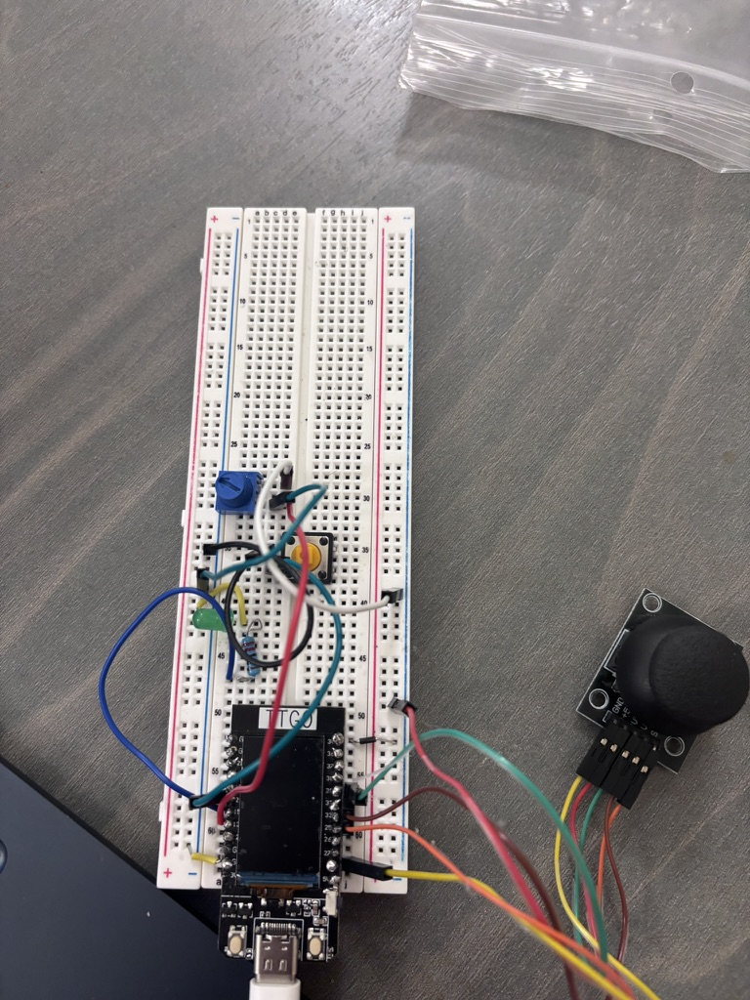
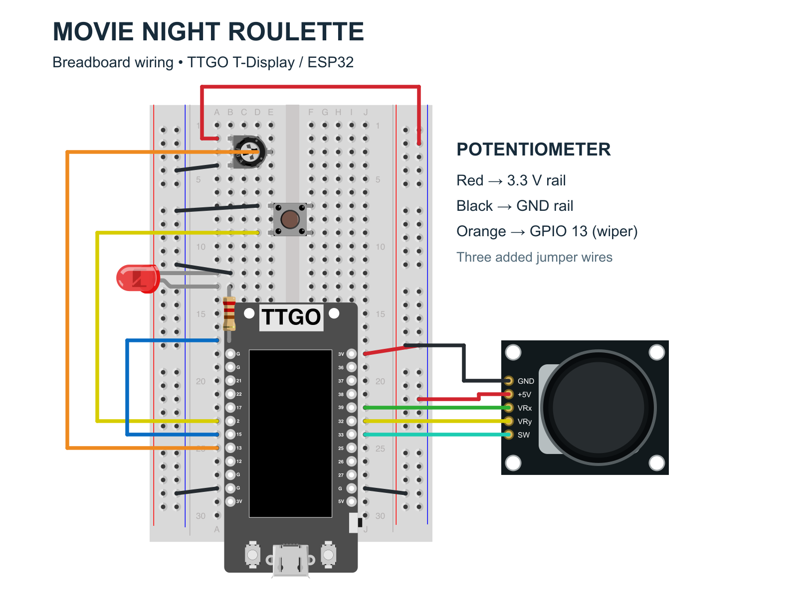

# Movie Night Roulette 🎬

I made Movie Night Roulette because choosing a movie with friends can take forever. I wanted to turn that indecision into a little physical game, where you pick what you're in the mood for and let a roulette decide the rest.

The controller uses an ESP32, a joystick, a potentiometer and a button. Moving the joystick changes the genre (comedy, romance, thriller, drama or action), turning the potentiometer changes the intensity from 1 to 5, and pressing the button spins for a movie. I put together a list of 75 movies for the game. It also keeps track of movies it's already picked during the session so you don't keep getting the same one.


## The setup

Here's what my actual circuit looked like:



I used a LilyGO TTGO ESP32 T-Display, breadboard, joystick, potentiometer, pushbutton, jumper wires and a USB cable.

The joystick X is connected to GPIO 39 and Y to GPIO 32, with its built-in switch on GPIO 33. The potentiometer uses GPIO 13, the button uses GPIO 2 and I connected an LED to GPIO 15 through a resistor. The joystick and potentiometer share 3.3V and ground. The button connects to ground and uses the ESP32's internal pull-up resistor.

**Fritzing circuit diagram:**



[Download the editable Fritzing sketch](media/Movie_Night_Roulette_Breadboard.fzz) · [Wiring details and part credits](media/wiring.md)

The breadboard diagram follows the GPIO assignments in the firmware and includes the potentiometer’s three jumper wires: red to 3.3 V, black to ground, and orange from the wiper to GPIO 13. The LED resistor is shown as a suggested 220 Ω because its value cannot be read from the photo.

## How the code works

The code is split into three parts that communicate with each other.

First, the Arduino sketch (`MovieNightRoulette.ino`) reads the joystick, potentiometer and button and sends their values to my laptop through USB serial communication at 115200 baud.

Then the Python server (`server.py`) receives these readings and makes them available to the website at `/api/state`.

Finally, the JavaScript code (`web/game.js`) takes the sensor values and uses them to control the game. It handles switching genres, selecting an intensity level, filtering the movies and playing the roulette animation. The website itself uses HTML, CSS and p5.js.

One of the trickier parts was getting the joystick to behave like a menu controller. Unlike a keyboard, the joystick doesn't just return left or right. It gives a continuous number depending on how far you move it. I had to make sure that holding it in one direction wouldn't immediately cycle through all five genres.

I ended up using this logic:

```javascript
const delta = d.x - center;
const now = performance.now();

if (Math.abs(delta) < 400)
  latched = false;

if (Math.abs(delta) > 900 &&
    (!latched || now - lastStep > 550)) {
  genre = (genre + (delta > 0 ? 1 : 4)) % 5;
  latched = true;
  lastStep = now;
  refresh();
}
```

Basically, the program checks how far the joystick has moved from its center. The `latched` variable prevents the menu from updating too frequently, and the 550 ms delay lets someone hold the joystick without it moving uncontrollably fast. I also included calibration because the center reading isn't necessarily exactly the same every time.

The button also required a little more logic than I initially expected. A physical button can briefly fluctuate between pressed and released when you touch it, so I used a 35 ms debounce check:

```cpp
if (now - changed >= 35 && raw != pressed) {
  pressed = raw;
  if (pressed) presses++;
}
```

Instead of sending only whether the button is being held down, Arduino counts the presses. The JavaScript code then checks whether that count has increased to trigger a new spin.

The potentiometer was another component I had trouble with. At one point the reading was stuck at zero, so I had to check the sensor values separately from the website to understand where the problem was happening.

I also added smoothing to the Arduino code:

```cpp
smoothPot += 0.12f *
  (analogRead(POT) - smoothPot);
```

This reduces small fluctuations in analog readings, making the controls more stable. It doesn't fix a disconnected sensor, but it helps prevent the displayed intensity from reacting to every tiny change in the readings.

Finally, I wanted the roulette to feel like a real roulette instead of immediately displaying a random movie. I used increasing delays between titles:

```javascript
if (step < 18) {
  setTimeout(tick, 45 + step * step * 1.5);
  return;
}
```

As the number of steps increases, the delay gets longer, so the roulette starts quickly and gradually slows down before revealing the movie.

I think this animation makes a big difference because I wanted picking a movie to feel like playing a small game rather than just using another recommendation website.

## How to run it

All the project code is in the `Movie_Night_Roulette_Documentation 2` folder in this repository.

You need Python 3, Arduino IDE with the Espressif ESP32 board package installed through Boards Manager, and a USB data cable. Select your TTGO T-Display board and serial port in Arduino IDE. The firmware needs no extra Arduino libraries beyond the ESP32 core.

Open `firmware/MovieNightRoulette/MovieNightRoulette.ino` from that folder in Arduino IDE and upload it to the ESP32. Then connect the board to your laptop using USB.

Close Arduino Serial Monitor if it's open, because the Python server needs to access the same serial port.

From the repository root, run:

```bash
cd "Movie_Night_Roulette_Documentation 2"
python3 server.py
```

Then open:

http://127.0.0.1:8765

On a Mac, you can also run `Start Movie Night.command` as a shortcut.

The web interface is in the `web` folder, and the Python server uses standard Python libraries without needing additional packages. The supplied server is designed for macOS/Linux.

[Watch the demo video](https://www.youtube.com/watch?v=oWBVLA43PA4).

## Final result

The part I enjoyed most was seeing something I physically built control a game on my laptop. It made me realize that something as simple as moving between menu options becomes a lot more complicated when you're working with actual sensors.

I also liked that the project ended up being something I could genuinely imagine using with friends.

I wrote more about my design process and technical challenges in my [Module 2 design documentation on Notion](https://smart-banjo-6d6.notion.site/Movie-Night-Roulette-3f35804c3855802c9766f99a3ee09156).
